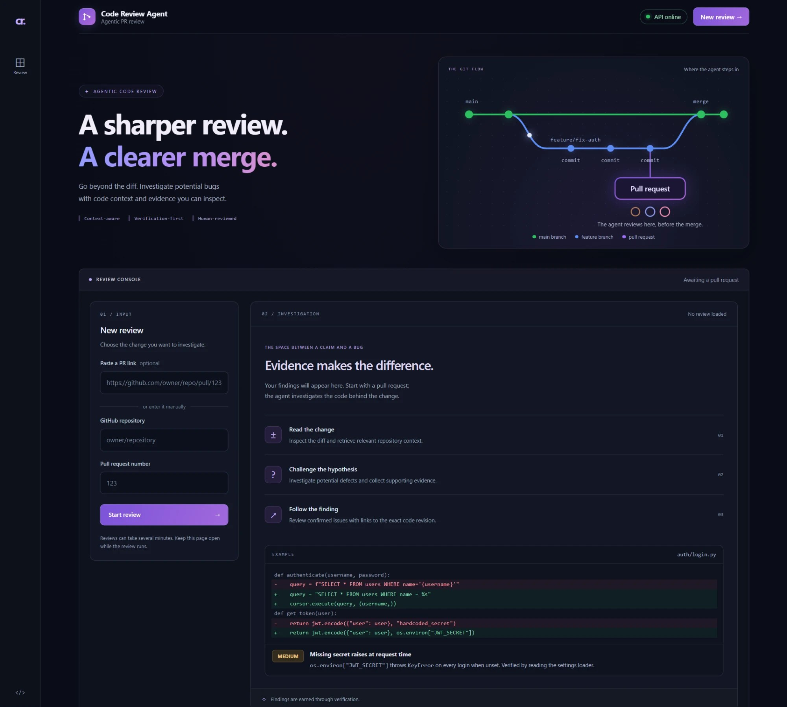

# Code Review Agent

An agentic, evidence-driven reviewer for GitHub pull requests.

- Routes each change to correctness, security and performance specialist agents
- Each specialist forms hypotheses about potential defects in the diff
- Verifies each one against the repository at the exact reviewed revision
- Reports only findings backed by evidence


<p align="center">
  
</p>

**Contents:** [Overview](#overview) · [Getting started](#getting-started) ·
[Configuration](#configuration) · [API](#api) · [Deployment](#deployment) ·
[Troubleshooting](#troubleshooting)

## Overview

- **Problem:** diff-only reviewers flag code that looks wrong in isolation but is fine in
  context (a caller, a config value, an existing test).
- **Approach:** every suspected defect must be backed by repository evidence, or optionally
  a sandboxed test run, before it is reported.
- **Result:** fewer findings, each traceable to its supporting evidence.

## Architecture

Each review runs as a multi-agent LangGraph system. A supervisor routes the change to
specialist reviewer agents, which run in parallel as separate subgraphs with their own
prompts, state and tool budgets. Every claim passes through one shared evidence judge:

```text
Fetch PR → Analyse diff → Load repository tree → Retrieve context → Supervisor
                                                                        │
                 ┌──────────────────────────┬───────────────────────────┤
                 ▼                          ▼                           ▼
          Correctness agent           Security agent            Performance agent
          (always runs)               (if relevant)             (if relevant)
                 │  For each hypothesis (maximum 5 per agent):
                 │    Reviewer ⇄ Tools (read_file, search_code, find_references,
                 │                      run_test, run_static_analysis)
                 │    Shared judge: evaluate evidence → confirm or discard
                 └──────────────────────────┴───────────────────────────┘
                                            ▼
                        Merge findings (one per location) → Generate review
```

## Key capabilities

- **Multi-agent:** a supervisor fans out to correctness, security and performance specialists
- **Hypothesis-driven:** up to five candidate defects per specialist, each investigated with tools
- **Evidence-gated:** only findings with valid citations reach the report
- **Revision-pinned:** inspection and links use the PR's exact commit SHA
- **Bounded:** 3 model turns and 6 tool calls per hypothesis, 30 tool calls per review shared across specialists
- **Sandboxed (optional):** pytest and Ruff in locked-down, network-less Docker containers
- **Transparent:** the UI shows each finding with its GitHub links and tool evidence
- **Measurable:** evaluation harness comparing three review architectures
- **Observable:** optional LangSmith tracing
- **Deployable:** HTTPS, authentication and a dedicated sandbox worker

## Technology stack

| Layer | Technologies |
| --- | --- |
| Agent orchestration | LangGraph (state graph, `ToolNode`), LangChain Core |
| Language model | OpenAI API (Responses API with structured outputs and configurable reasoning effort) |
| Backend | Python 3.13, FastAPI, Uvicorn, Pydantic, pydantic-settings, HTTPX |
| Source control integration | GitHub REST API |
| Frontend | React 19, TypeScript, Vite |
| Code execution sandbox | Docker, pytest, Ruff |
| Gateway and hosting | Caddy (automatic HTTPS, Basic authentication), Docker Compose, systemd (sandbox worker) |
| Observability | LangSmith (optional) |
| Testing | pytest, Vitest, React Testing Library, jsdom |
| Tooling | uv (Python dependency management), npm |

## Getting started

### Prerequisites

- Python 3.13 or later and [uv](https://docs.astral.sh/uv/)
- Node.js 22.12 or later
- A GitHub token with read access to the repositories to be reviewed
- An OpenAI API key

### Installation and launch

1. Create a `.env` file in the repository root:

   ```dotenv
   github_token=...
   openai_api_key=...
   ```

2. Build the web interface:

   ```bash
   cd frontend && npm ci && npm run build && cd ..
   ```

3. Start the API and web interface together:

   ```bash
   uv run python -m app.scripts.run_api --serve-ui --port 8001
   ```

- Open http://127.0.0.1:8001 and enter a PR URL, e.g. `https://github.com/owner/repo/pull/123`.
- Reviews are synchronous and not persisted; keep the page open until the report appears.
- For frontend development, run the API as above plus `npm run dev` in `frontend/`.

## Configuration

- Read from environment variables or a `.env` file in the repository root (case-insensitive).
- Only `github_token` and `openai_api_key` are required for local use.

| Setting | Default | Description |
| --- | --- | --- |
| `github_token` | — | **Required.** Reads PRs and repository files |
| `openai_api_key` | — | **Required.** Model requests |
| `verification_reasoning_effort` | `none` | Reviewer reasoning: `none`, `low`, `medium`, `high` |
| `sandbox_enabled` | `false` | Enables test and lint execution |
| `sandbox_image` | `code-review-sandbox:stage9` | Sandbox image |
| `sandbox_worker_url`, `sandbox_worker_token` | — | Remote worker URL and token (32+ chars) |
| `environment` | `development` | `production` enforces the checks below |
| `api_access_token` | — | API bearer token (32+ chars, production) |
| `public_origin` | — | Public HTTPS origin (production) |
| `langsmith_tracing` | `false` | LangSmith tracing (traces include code) |
| `langsmith_api_key`, `langsmith_project`, `langsmith_endpoint` | — | LangSmith connection |

- Production startup fails if:
  - the access token is missing or shorter than 32 characters
  - the public origin is not a bare HTTPS origin
  - sandbox execution is enabled without a dedicated worker

## API

The web interface uses a single endpoint, which can also be called directly. When
`api_access_token` is set, add `-H "Authorization: Bearer <token>"`.

```bash
curl -s http://127.0.0.1:8001/api/v1/reviews \
  -H "Content-Type: application/json" \
  -d '{"repository": "owner/repo", "pull_request_number": 123}'
```

- The response contains:
  - `pull_request`: PR metadata
  - `findings`: confirmed issues, each with `file`, `line`, `severity`, `title`, `explanation`
    and `category` (the specialist that reported it)
  - `tool_calls`: the evidence behind the findings, each tagged with its `specialist`
    (`null` for shared context retrieval)
  - `specialists`: the specialist agents the supervisor ran

| Status | Meaning |
| --- | --- |
| `200` | Review completed |
| `400` | Malformed repository name |
| `401` | Missing or invalid bearer token |
| `404` | PR or repository not found or not readable |
| `502` | GitHub API request failed |

Interactive OpenAPI docs are served at `/docs` in development.

## Sandboxed execution

Disabled by default; verification then relies on reading and searching code. To enable
pytest and Ruff runs, install Docker and build the trusted image:

```bash
docker build -t code-review-sandbox:stage9 sandbox
```

- Set `sandbox_enabled=true` and restart the API.
- Images are never pulled at review time, and containers have no network access.
- In production, use a dedicated worker via `sandbox_worker_url` instead of giving the API
  Docker access.

## Evaluation

`evaluation/` holds 20 synthetic defective and 10 synthetic clean Python PRs, used to compare
three review architectures:

| Mode | Behaviour |
| --- | --- |
| `diff_only` | Structured review of the diff alone |
| `context` | Context retrieval followed by a structured review |
| `verification` | Full multi-agent hypothesis and evidence graph |

```bash
# Offline wiring check (no external requests)
uv run python -m app.scripts.evaluate

# Live run against the OpenAI API (incurs cost)
uv run python -m app.scripts.evaluate --live --limit 1 --output evaluation/results/live-smoke.json
```

- Findings are adjudicated manually against known defects, then rescored with `--score-report`.
- Model quality has not yet been measured on this dataset.
- Scoring and metrics: [evaluation guide](evaluation/README.md).

## Testing

```bash
uv run --with pytest python -m pytest -q     # backend
cd frontend && npm test                       # frontend
```

Both suites use mocked services and make no external network requests.

## Deployment

- `deploy/` provides a Docker Compose setup with two services:
  - **Caddy gateway:** HTTPS, Basic authentication, serves the frontend, proxies `/api`
  - **FastAPI service:** never exposed directly
- The sandbox worker runs on a separate, optional Linux host managed by systemd.

```bash
cd deploy
cp production.env.example production.env && chmod 600 production.env   # populate the values
docker compose --env-file production.env up -d --build
```

## Security

- Secrets are supplied exclusively through environment variables and are never included in
  the frontend build.
- In production, the API requires a bearer token, which the gateway injects server-side.

## Troubleshooting

| Symptom | Resolution |
| --- | --- |
| Validation error on startup | Missing setting or failed production check; the error names it |
| `Build the local UI first` | Run `npm ci && npm run build` in `frontend/` |
| `requires environment=development` | `--serve-ui` is local-only; use `deploy/` for production |
| `404 Pull request or repository not found` | Check token access and the PR number |
| Slow reviews | Expected: reviews are synchronous; keep the page open |
| Execution evidence always incomplete | Enable the sandbox, build the image, check Docker access |

## Project structure

```text
app/graph/       LangGraph workflow (nodes, routing, state)
app/tools/       Repository and verification tools available to the model
app/services/    GitHub, OpenAI, context and sandbox services
app/evaluation/  Evaluation dataset loader, runner and metrics
frontend/        React + TypeScript web interface (Vite)
deploy/          Docker Compose, Caddy, Dockerfiles and sandbox worker unit
sandbox/         Image for isolated pytest and Ruff runs
```

## Documentation

- [Evaluation guide](evaluation/README.md)
